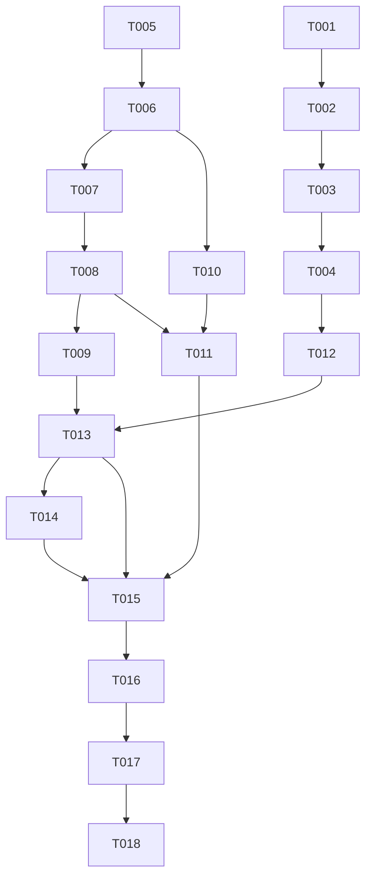

# Tasks: AppleUI 社区液态玻璃导航接入

**Input**: Design documents from `/Users/pangyude/AiCode/wx/harmonyos-api/harmonyos-api-lab/spec/appleui-glass-tabs/`
**Prerequisites**: plan.md (required), spec.md (required for user stories)

**Tests**: 未要求新增自动化测试；验证以编译、部署和真机操作为准。本次父流程选择 `Run verification`，因此 Verification 阶段只包含构建和部署，不包含逐故事 UI 自动化验证。

**Organization**: 任务按用户故事分组，US1 为 MVP，US2 保证业务状态跨方案一致，US3 保证能力不足时准确说明。

## Format: `[ID] [P?] [Story] Description`

- **[P]**: 可并行执行（不同文件、无未完成依赖）
- **[Story]**: US1 / US2 / US3
- 所有路径均相对于 `apps/mf_liquid_glass_tabs/`

## Path Conventions

- 应用根目录：`apps/mf_liquid_glass_tabs/`
- 页面：`entry/src/main/ets/pages/`
- 组件：`entry/src/main/ets/components/`
- 服务：`entry/src/main/ets/service/`
- 模型与常量：`entry/src/main/ets/model/`、`entry/src/main/ets/constants/`
- 依赖与模块配置：`entry/oh-package.json5`、`entry/src/main/module.json5`
- 资源与本地图片：`entry/src/main/resources/`
- 文档：仓库根目录 `spec/appleui-glass-tabs/` 与应用内 `README.md`

## Phase 1: Setup (Shared Infrastructure)

**Purpose**: 安装并锁定 AppleUI 2.1.0，确认原生库与工程依赖可用。

- [X] T001 Add `com.hm.appleui.hw` `2.1.0` to `entry/oh-package.json5`, run ohpm install at the app project root, and keep the generated lock file in `entry/oh-package-lock.json5` or the project-level lock.
- [X] T002 Verify the installed AppleUI package under `entry/oh_modules/com.hm.appleui.hw` exposes `AppleUI`, contains `libs/arm64-v8a/libliquidglass.so` and `libc++_shared.so`, and requires API 20+; record the exact package version and native ABI in a temporary note for the final report.

---

## Phase 2: Foundational (Blocking Prerequisites)

**Purpose**: 能力检查、透明导航点击层和统一的社区方案配置；这些在任何用户故事之前完成。

**⚠️ CRITICAL**: No user story work can begin until this phase is complete.

- [X] T003 [P] Define the AppleUI capability result type (available, libraryVersion, abiSupported, apiSupported, statusText) in `entry/src/main/ets/service/CapabilityService.ets`.
- [X] T004 Implement `CapabilityService` in `entry/src/main/ets/service/CapabilityService.ets` using `deviceInfo.abiList` and `deviceInfo.sdkApiVersion`, with a fixed library version `2.1.0`; do not perform network calls or request permissions.
- [X] T005 [P] Add a transparent-surface mode to `entry/src/main/ets/components/BottomNavBar.ets` that keeps height, radius, layout, icons, text, badge and click handlers, but draws no white background, no border and no shadow when enabled; default behavior must remain unchanged.

**Checkpoint**: Capability types, capability service and transparent click layer are ready; no business page was rewritten.

---

## Phase 3: User Story 1 - 切换到社区液态玻璃导航 (Priority: P1) 🎯 MVP

**Goal**: 新增社区方案，底部出现单个 AppleUI 液态玻璃胶囊，四个导航入口和业务页面可用。

**Independent Test**: 在支持设备上只走社区方案：进入演示设置选择社区，回到推荐页，确认一个玻璃胶囊覆盖底部导航、四个入口可点击、商品列表可滚动。

### Implementation for User Story 1

- [X] T006 [US1] Create `entry/src/main/ets/components/CommunityShoppingTabs.ets` with a `Stack(alignContent: Alignment.Bottom)` containing, in order, a `Tabs` with `barHeight(0)`, a single AppleUI lens row, and a transparent `BottomNavBar` click row; reuse `RecommendedPage`, `CategoryPage`, `BagPage` and `ProfilePage(currentMode: 2)`.
- [X] T007 [US1] In `entry/src/main/ets/components/CommunityShoppingTabs.ets`, configure the single lens with content width minus 32vp, height 68vp, bottom margin 14vp, `Circle='100%'`, `Blur=0`, `NeoStrength=0.22`, `ProUI=false`, `Vibrate=false`; keep the glass row and click row free of opaque backgrounds.
- [X] T008 [US1] In `entry/src/main/ets/pages/Index.ets`, add the mode 2 community branch, allow `changeScheme(2)`, pass the shared `CartStore` and material status, and log scheme switches with `MfShop` and an emoji prefix; do not add VIBRATE permission.
- [X] T009 [P] [US1] In `entry/src/main/ets/pages/ProfilePage.ets`, show the community scheme as available with actual AppleUI version and single-lens wording; remove the `未接入` badge for the community option and keep the existing ordinary/official rows unchanged.

**Checkpoint**: Community mode is selectable and renders one glass capsule over live content; nav and page operations remain usable.

---

## Phase 4: User Story 2 - 业务页面与购物袋在三套方案间保持一致 (Priority: P1)

**Goal**: 社区/普通/官方共享同一个购物袋和业务回调，切换不重置、不重复。

**Independent Test**: 在任一方案加入 2 件商品并改数量，切到另外两套方案，再回购物袋核对商品、数量和合计。

### Implementation for User Story 2

- [X] T010 [US2] In `entry/src/main/ets/components/CommunityShoppingTabs.ets`, wire the shared `CartStore` into all four pages, keep the bag badge count from `cart.count`, reuse `onGoShopping` to switch to tab 0, and avoid creating a second store or second AppleUI instance.
- [X] T011 [US2] In `entry/src/main/ets/pages/Index.ets` and `entry/src/main/ets/components/CommunityShoppingTabs.ets`, ensure conditional rendering destroys the community wrapper when leaving mode 2, recreates exactly one AppleUI when returning, and preserves the `CartStore` across mode changes; add lifecycle logs with an emoji prefix.

**Checkpoint**: Cart contents, quantities, totals and deletion survive all three schemes; no duplicate glass instance.

---

## Phase 5: User Story 3 - 能力不足时准确说明，不伪造接入成功 (Priority: P2)

**Goal**: 设置页展示实际库版本和 ABI/API 结论；不支持时不把社区方案当作可用或成功。

**Independent Test**: 在非 arm64 或低 API 设备上查看设置页，社区入口不可选并显示原因；在 Pura X 上显示 arm64/API 26/2.1.0 结论。

### Implementation for User Story 3

- [X] T012 [P] [US3] Update `entry/src/main/ets/constants/ShopData.ets` and `entry/src/main/ets/model/Product.ets` so the community scheme description names `AppleUI 2.1.0` and the single-lens capability; do not claim runtime rendering success.
- [X] T013 [US3] In `entry/src/main/ets/pages/ProfilePage.ets`, consume `CapabilityService`, disable the community row when ABI/API is unsupported, show the reason and the actual version when supported, and update the About panel text from “未接入” to the verified integration wording.
- [X] T014 [P] [US3] Confirm `entry/src/main/module.json5` contains no `ohos.permission.VIBRATE` and no new permission; add a `MfShop` log with an emoji prefix when the community capability check succeeds or fails.

**Checkpoint**: Unsupported devices cannot select community; supported devices see an accurate capability statement and no false “render success” claim.

---

## Phase 6: Polish & Cross-Cutting Concerns

**Purpose**: 文档、静态检查和交付记录收口。

- [X] T015 Update `README.md` with the actual AppleUI version, native ABI/SDK constraints, dependency install step, final lens parameters, single-lens structure, failure/known-issue notes, and the fact that UI verification was not part of this verification scope; retain the existing image-source note.
- [X] T016 Run `arkts_check` on all modified `.ets` files, fix all reported errors, and record the command/result; do not change native AppleUI sources.

---

## Phase 7: Verification

<!-- verification_scope: build-only -->

**Purpose**: Build and deploy the implemented feature; no per-story UI verification in this scope.

- [X] T017 Build the app with `devecocli build`, fix compilation errors, and confirm the HAP includes the AppleUI dependency and arm64 native library.
- [X] T018 Deploy the built HAP to the available arm64 device with the existing temporary signing flow, restore the clean bundle/signing configuration afterward, and record the deployment result and bundle name.

> T017 result: `devecocli build` succeeded; the HAP contains `libs/arm64-v8a/libliquidglass.so` and `libs/arm64-v8a/libc++_shared.so`, bundle `com.mf.liquidglasstabs`. The AppleUI HAR manifest declares `ohos.permission.VIBRATE`, but the final HAP `module.json` has no `requestPermissions`; the app itself remains permission-free.
>
> T018 result: **completed on retry**. Adding `"signingConfig": "default"` to the default product made the existing `default_mf_liquid_glass_tabs` material usable with bundle `com.mf.liquidglasstabs`; `SignHap` succeeded and the signed HAP (6,851,642 bytes) installed on HUAWEI Pura X (56V0225808006330). The app launched and the community glass rendered. Manual spot checks covered four tabs, live sampling, scroll, search/filter, cart add/quantity/delete, cross-scheme cart retention, page re-entry, and foreground resume. These were outside the build-only scope and were not automated. Clean `AppScope/app.json5` and `build-profile.json5` were restored afterward; screenshots and logs are referenced in the final report.
>
> Follow-up alignment fix: official HdsTabs measures 272 × 68vp at bottom 14vp with four item centers at 381 / 567 / 753 / 940. `BottomNavBar`, `PlainShoppingTabs`, and `CommunityShoppingTabs` now share `NAV_BAR_WIDTH=272`, `NAV_BAR_HEIGHT=68`, `NAV_BAR_BOTTOM=14`, and 12vp side inset (62vp per item); the AppleUI lens is 272vp wide. Device re-check: ordinary and community labels/bars match those centers, and all four tabs switch at the official centers. White-page visibility was improved with a very light `#0D000000` / 18vp / offsetY 6 shadow on the transparent click layer; the lens center remains transparent. Final clean build succeeds; signing config removed afterward.

---

## Dependencies & Execution Order

### Phase Dependencies

- **Setup (Phase 1)**: T001 must finish before T002; both touch dependency state.
- **Foundational (Phase 2)**: T003 and T005 can run in parallel; T004 follows T003; all block user stories.
- **US1 (Phase 3)**: T006 → T007 → T008; T009 can run in parallel after T006 because it touches only `ProfilePage.ets`.
- **US2 (Phase 4)**: T010 follows T006; T011 follows T008 and T010.
- **US3 (Phase 5)**: T012 before T013; T014 is independent of T013 but after T004.
- **Polish (Phase 6)**: T015 and T016 after all stories; T016 after T015.
- **Verification (Phase 7)**: T017 before T018.

### User Story Dependencies

- **US1 (P1)**: Depends on Setup + Foundational; no dependency on US2/US3.
- **US2 (P1)**: Depends on Setup + Foundational; integrates with US1 via the shared `CartStore`.
- **US3 (P2)**: Depends on Setup + Foundational; can be developed in parallel with US1/US2 after T004.

### Within Each User Story

- US1: create wrapper → configure lens → wire Index; Profile label can be parallel.
- US2: cart wiring → lifecycle/single-instance behavior.
- US3: constants/model → Profile capability UI; module permission check parallel.

## 📊 Dependency Graph

## ⚡ Parallel Execution Guide

| Phase | Tasks | Required Files | Execution Notes |
|---|---|---|---|
| Setup | T001, T002 | `entry/oh-package.json5`, lock files | T001 must finish before T002; both touch dependency state |
| Foundational | T003, T005 | `service/CapabilityService.ets`, `components/BottomNavBar.ets` | Independent files; T004 follows T003 |
| US1 | T006 → T007 → T008; T009 in parallel after T006 | `components/CommunityShoppingTabs.ets`, `pages/Index.ets`, `pages/ProfilePage.ets` | T006/T007 share a file; T008 and T009 are different files |
| US2 | T010, T011 | `components/CommunityShoppingTabs.ets`, `pages/Index.ets` | T010 follows T006; T011 follows T008/T010 |
| US3 | T012, T013, T014 | `constants/ShopData.ets`, `model/Product.ets`, `pages/ProfilePage.ets`, `module.json5` | T012 before T013; T014 independent |
| Polish | T015, T016 | `README.md`, all modified `.ets` | T015 after implementation; T016 after T015 |
| Verification | T017, T018 | HAP output, device | Build before deploy; UI verification intentionally omitted per `build-only` scope |

## Parallel Example

- After T006, T009 can be developed alongside T007/T008 because it only changes `ProfilePage.ets`.
- T003 and T005 can be implemented at the same time because they touch different files.
- After T004, T012 can start while US2 cart/lifecycle work is in progress.

## Implementation Strategy

### MVP First (User Story 1 Only)

1. Complete Setup and Foundational.
2. Implement US1: community wrapper, AppleUI lens, Index mode branch, ProfilePage community label.
3. Stop and validate that one lens renders over live content and nav works.
4. Then add US2 consistency and US3 capability handling.

### Incremental Delivery

1. Setup + Foundational → dependency and transparent click layer ready.
2. US1 → community navigation MVP.
3. US2 → cart/lifecycle consistency.
4. US3 → capability accuracy.
5. Polish + Build + Deploy.

## Notes

- `[P]` tasks touch different files and have no incomplete dependencies.
- `[Story]` maps tasks to `spec.md` user stories.
- No automated test tasks were requested; verification is build + deploy only per the selected scope.
- No UI verification task is included; the final report must mark UI checks as not run in this scope.
- Do not modify native AppleUI sources or `mf_api`.
- Do not add VIBRATE permission or enable ProUI/Vibrate.

### Summary Report

- Total tasks: **18**
- Setup: 2
- Foundational: 3
- US1: 4
- US2: 2
- US3: 3
- Polish: 2
- Verification: 2
- Suggested MVP scope: US1 after Setup + Foundational.
- Independent test criteria: US1 single lens + four nav interactions; US2 cart state across schemes; US3 capability status on unsupported/supported device.
- Verification scope: **build-only** per parent gate; no UI verification task included.
